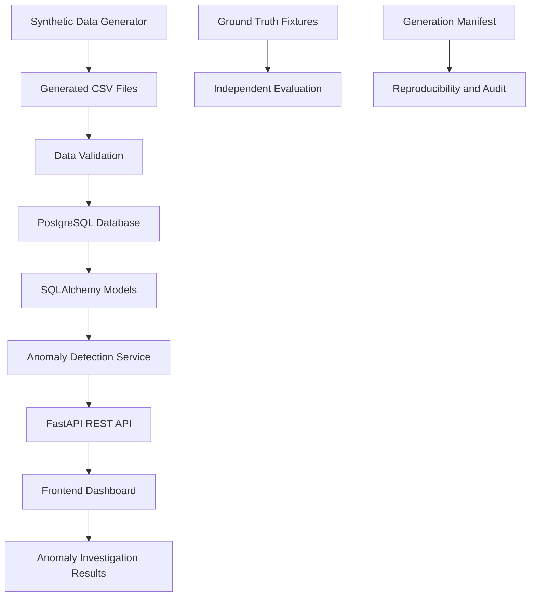

# MarketGuard Architecture

## 1. System Overview

MarketGuard is a Marketplace Seller Operations, Compliance & Payout Intelligence Platform.

It monitors marketplace operations, evaluates seller compliance and financial transactions, detects operational anomalies, and presents investigation results through a web dashboard.

The application uses PostgreSQL for persistent storage, SQLAlchemy for database interaction, FastAPI for backend API services, and HTML, CSS, and JavaScript for the frontend dashboard.

## 2. Technology Stack

| Component | Technology |
|---|---|
| Backend | Python, FastAPI |
| Database | PostgreSQL |
| ORM | SQLAlchemy |
| Frontend | HTML, CSS, JavaScript |
| Data Processing | Python |
| Data Validation | Custom Python validation scripts |
| Testing | Pytest |
| API Documentation | FastAPI Swagger UI |
| Version Control | Git and GitHub |

## 3. System Architecture



## 4. Application Layers

### 4.1 Data Generation Layer

The synthetic data generation module is implemented in:

` scripts/generate_data.py `

It generates marketplace operational records using a configurable dataset scale and random seed.

The starter dataset includes:

- Sellers
- Product listings
- Orders
- Order lines
- Order-seller relationships
- Fulfillments
- Customer reviews
- Disputes
- Commission rules
- Payouts
- Payout lines
- Seller status history
- Fulfillment events
- Dispute events
- Payout events

Generated CSV files are stored in `data/generated/`.

The generation manifest is stored in `data/manifests/generation_manifest.json`.

### 4.2 Data Validation Layer

Implemented in:

` scripts/validate_data.py `

The validation process checks:

- Required CSV files and column schemas.
- Primary-key uniqueness.
- Foreign-key relationships.
- Valid status and enum values.
- Financial calculations and arithmetic consistency.
- Seller and listing relationships.
- Payout eligibility conditions.
- Event-history consistency.
- Ground-truth fixture structure and record references.

Validation results are stored in `reports/validation_report.json`.

### 4.3 Database Layer

MarketGuard uses PostgreSQL as its primary system of record.

Database connectivity and session management are implemented in:

`backend/app/database.py`

SQLAlchemy models are maintained in:

`backend/app/models/`

The database contains 15 operational tables. Foreign-key constraints maintain relationships between marketplace entities.

Financial values use decimal-based database types to avoid floating-point inaccuracies.

Lifecycle changes are represented using event-history tables where applicable, including:

- `seller_status_history`
- `fulfillment_events`
- `dispute_events`
- `payout_events`

### 4.4 Data Loading Layer

Implemented in:

`scripts/load_data.py`

The loader imports validated CSV records into PostgreSQL.

It performs schema checks, type conversion, dependency-aware insertion, and database row-count verification.

The loading process uses transactions to maintain database consistency.

Ground-truth evaluation fixtures are intentionally excluded from operational database loading.

### 4.5 Anomaly Detection Layer

Implemented in:

`backend/app/services/anomaly_detector.py`

The anomaly detection service evaluates operational database records against five business rules:

1. **Payout Before Delivery Hold:** Identifies payouts made before the seven-day delivery hold expires.
2. **Duplicate Commission:** Identifies commission amounts exceeding the expected effective-dated commission calculation.
3. **Suspended Seller Active Listing:** Identifies active product listings belonging to suspended sellers.
4. **Lost Dispute Not Deducted:** Identifies lost refund or chargeback disputes that are not appropriately deducted from payout calculations.
5. **Payout Header Mismatch:** Identifies differences between payout header totals and the sum of payout-line net amounts.

Each detected anomaly includes its type, severity, description, related record identifiers, expected values, observed values, and recommended action.

The detector evaluates operational database records independently of the evaluation-only ground-truth fixtures.

### 4.6 API Layer

Implemented using FastAPI.

Application entry point:

`backend/app/main.py`

Anomaly endpoints:

| Method | Endpoint | Purpose |
|---|---|---|
| POST | `/api/v1/anomalies/scan` | Executes anomaly detection and returns results |
| GET | `/api/v1/anomalies/summary` | Returns anomaly counts by severity and type |
| GET | `/health` | Checks application health |

FastAPI automatically provides interactive API documentation through `/docs`.

### 4.7 Frontend Dashboard

The frontend is implemented using HTML, CSS, and JavaScript.

Frontend structure:

```text
frontend/
├── index.html
├── css/
│   └── styles.css
└── js/
    └── app.js
```

The dashboard provides:

- Backend connection status.
- Anomaly scanning.
- Anomaly count indicators.
- Severity-based insights.
- Anomaly category distribution.
- Search and severity filtering.
- Investigation records and recommendations.

The frontend communicates with the FastAPI backend through REST API requests.

## 5. Ground Truth and Evaluation Design

Ground-truth anomaly fixtures are maintained separately from operational input data.

Location:

`data/ground_truth/anomaly_fixtures.json`

The fixtures contain five labeled anomaly scenarios with expected and observed values and references to relevant operational records.

They are used for validation and evaluation, not as direct inputs to the operational anomaly detection service.

This separation helps prevent evaluation labels from leaking into the detection logic.

## 6. Testing Strategy

MarketGuard uses automated tests and data validation to verify application behavior.

The testing strategy includes:

- Data generation and validation checks.
- Database relationship and row-count verification.
- Individual anomaly detection rule tests.
- FastAPI endpoint verification.
- Frontend-to-backend integration checks.

Anomaly detection tests are maintained in:

`backend/tests/test_anomaly_detector.py`

Tests use an isolated SQLite test database so they do not modify the operational PostgreSQL database.

## 7. Reproducibility and Auditability

MarketGuard supports reproducible synthetic data generation through configurable random seeds.

The generation manifest records dataset metadata and file checksums.

Validation reports provide evidence of dataset integrity and ground-truth fixture checks.

Event-history tables preserve relevant lifecycle transitions instead of relying exclusively on the latest entity status.

## 8. Current Implementation Scope

The current starter implementation contains:

- 15 operational database tables.
- 11,678 generated operational records.
- Five ground-truth anomaly scenarios.
- Five implemented anomaly detection rules.
- FastAPI backend endpoints.
- A web-based operations dashboard.
- Automated anomaly detection tests.
- Data validation and database loading scripts.

The current starter dataset produces seven suspended-seller active-listing anomalies during the verified database scan. The remaining detection rules are covered by isolated automated tests.
